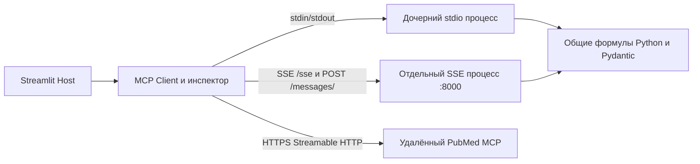

# Клинические инструменты MCP

Учебное приложение практической работы № 2: пять клинических калькуляторов, удалённый PubMed и инспектор JSON-RPC. Все операции инструментов из интерфейса проходят через настоящий MCP. LLM и модели машинного обучения в текущем пайплайне не используются. Платный API модели не требуется.

[Открыть приложение](https://n9nrqsghaw8zqgfnrx4tku.streamlit.app/)

## Запуск

Python 3.12. Первоначальная установка из корня репозитория:

```powershell
python -m venv .venv
.\.venv\Scripts\python.exe -m pip install -r requirements-dev.txt
```

После установки: `.\run.ps1`. Альтернатива: `.\.venv\Scripts\python.exe -m streamlit run streamlit_app.py`. Остановка: Ctrl+C. На Linux используйте `.venv/bin/python`.

## Использование

Выберите MCP-источник и нажмите «Обнаружить инструменты (tools/list)». Отфильтруйте каталог по направлению или русскому/английскому названию. Заполните форму, проверьте единицы и подтвердите данные. Нажмите «Выполнить»: Host покажет значение, компоненты, ограничения и источник. Снятый флажок означает «нет» только после явного подтверждения пользователем. Внизу раскрывается инспектор реального обмена.

## Архитектура



| Вариант | Инструменты | Жизненный цикл |
|---|---|---|
| 1 stdio | BMI, CKD-EPI, Cockcroft–Gault, каталог | SDK запускает процесс на операцию и закрывает каналы |
| 2 SSE | пять калькуляторов и каталог, всего 6 | отдельный процесс, readiness /health, cache_resource и lock |
| 3 внешний | фактический каталог PubMed MCP, в проверке 7 | удалённый HTTPS endpoint, deadline 12 с, TTL 300 с |

Серверы: `python -m clinical_mcp.server` и `python -m clinical_mcp.server --sse --port 8000`. Сетевые маршруты: GET /sse, POST /messages/?session_id=…, GET /health. Общие формулы находятся в одном модуле. В облаке оба локальных процесса работают на узле Streamlit, а не на компьютере пользователя.

ClientSession официального mcp==2.3.0 выполняет initialize, notifications/initialized, tools/list с пагинацией и tools/call. Проверенный протокол — 2025-11-25. Версия SDK 2.3.0 доступна и удовлетворяет указаниям PDF 2.x и >=1.3.0. [Официальные исходники](https://github.com/modelcontextprotocol/python-sdk/tree/v2.3.0).

Для локальных операций общий бюджет 15 с, SSE допускает две попытки. Для внешних — 12 с и одна попытка. Контекстные менеджеры закрывают сессии. Диагностика stdio направляется в stderr. Ошибки инструмента возвращаются структурированно с isError.

## Методики

| Инструмент | Версия и результат | Источник |
|---|---|---|
| bmi | кг/м², фактическая масса и рост | [CDC](https://www.cdc.gov/growth-chart-training/hcp/using-bmi/calculating-bmi.html) |
| ckd_epi_2021 | креатинин, без расового коэффициента, мл/мин/1.73 м² | [Inker 2021](https://doi.org/10.1056/NEJMoa2102953) |
| cockcroft_gault | 1976, фактическая масса, мл/мин | [Первичная публикация](https://pubmed.ncbi.nlm.nih.gov/1244564/) |
| cha2ds2_vasc | Lip 2010, 0–9 баллов | [Первичная публикация](https://pubmed.ncbi.nlm.nih.gov/19762550/) |
| gcs | E+V+M, 3–15 баллов | [Glasgow assessment aid](https://www.glasgowcomascale.org/downloads/GCS-Assessment-Aid-English.pdf?v=2) |
| list_calculators | JSON Schema, диапазоны, единицы и ограничения | метаданные общих методов |

Почечные формулы для взрослых при стабильном креатинине; ограничения при ОПП, беременности, диализе и необычной мышечной массе. Креатинин umol/L делится на 88.4 для mg/dL. СКФ индексирована, клиренс Cockcroft не индексирован. При NT в GCS сумму не считают. CHA₂DS₂-VASc — версия 2010, не CHA₂DS₂-VA. Технические диапазоны не доказывают применимость формулы к пациенту. Интерпретация нейтральная, без произвольных цветов риска и персональных назначений.

Sanitizer обрабатывает пробелы, десятичную запятую и допустимые типы, не подставляя отсутствующие измерения. Формы строятся по фактическому tools/list: числа, enum, checkbox, строки, JSON для массивов/объектов.

ObservedStream наблюдает реальные SDK SessionMessage на send/receive. Это нормализованная JSON-модель на границе транспорта, не заново собранный запрос. История: 8 операций по 80 сообщений в памяти сеанса. Заголовки не собираются, секретные поля редактируются. Кэш не создаёт фиктивного обмена.

## Внешний сервис и настройки

Endpoint: https://pubmed.mcp.claude.com/mcp. [Документация владельца](https://academy.claude.com/tutorials/using-the-pubmed-connector-in-claude). Доступ при проверке не требовал ключа или оплаты. Внутренние AI-модели сервиса не установлены по клиентскому коду. Приложение не вызывает LLM для поиска, расчётов или координации.

Env: MCP_AUTO_START=1 (0 для ручного запуска SSE); LOCAL_MCP_URL=http://127.0.0.1:8000/sse; EXTERNAL_MCP_URL — замена удалённого Streamable HTTP endpoint; EXTERNAL_MCP_TOKEN — необязательный Bearer из env или Streamlit Secrets. Не сохраняйте секреты в коде. Кэш внешних результатов действует 300 с в текущем сеансе, до 20 записей.

## Проверки и облако

`python -m pytest -q`, `python -m pip check`, `python scripts/live_check.py`. Последний сценарий требует Интернет. Тесты используют реальные stdio/SSE, проверяют расчёты, валидацию, отсутствие удалённых инструментов, отказ сервера и UI. Полный Windows-снимок зависимостей — requirements-lock-windows.txt, для Linux используйте requirements.txt.

Community Cloud: main, streamlit_app.py, Python 3.12. Supervisor управляет локальным SSE-процессом в облачном окружении. Фактический статус проверок — [verification.md](docs/verification.md). [Сценарий защиты](docs/defense.md), [матрица требований](docs/requirements.md).

Текущая версия по запросу пользователя содержит только клинические инструменты и PubMed. Первый проект в соседнем репозитории не изменён. Материалы и проверки прежнего лекарственного сценария доступны в истории Git.
