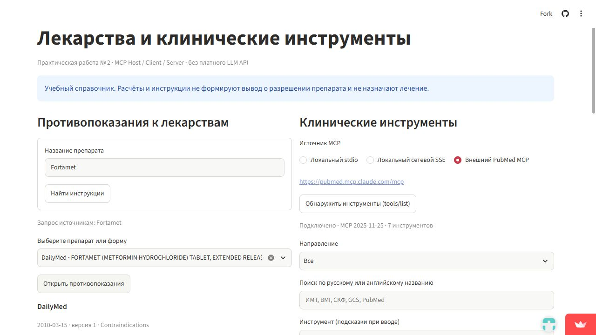

# Проверки 22 ноября 2026

Windows, Python 3.12.14, MCP SDK 2.3.0, Streamlit 1.67.0.

- `pytest`: **18 passed**, включая реальный UI-тест stdio; повторный окончательный прогон после правок также прошёл.
- `pip check`: No broken requirements found.
- Настоящий stdio: initialize 2025-11-25, initialized, tools/list (4), tools/call BMI 22.86; неверная масса → isError, закрытие контекстом SDK.
- Настоящий SSE: отдельный процесс, /health, /sse, POST /messages/; tools/list (10), GCS=15; после завершения процесса закрытый порт → контролируемая ошибка.
- Инспектор: test_protocol сверяет id и content с полученным SDK ответом.
- 11 регрессионных тестов первой работы перенесены для SPL/PDF и сопоставления; исходный проект не изменён.
- Внешний PubMed: настоящий SDK initialize/list, search_articles по DOI 10.1056/NEJMoa2102953 → PMID 34554658 за 1437 мс; get_article_metadata → библиография и DOI за 1359 мс. Ключ/оплата не требовались.
- DailyMed Fortamet → SPL 8cbcee12-3eb1-4726-9212-5dddc39a3b0f, версия 1, дата 2010-03-15, раздел Contraindications и прямая ссылка. Документ исторический.
- Drugs@FDA: фактический HTTP 403 от api.fda.gov. Успешный живой поиск FDA из этого окружения не заявляется. DailyMed работает независимо.
- Браузер localhost:8502: stdio обнаружение, числовые поля, BMI=22.86, отрицательная масса, инспектор. Конфликт ключа лекарственной формы исправлен; повторный AppTest с настоящим SSE прошёл.
- Браузер: SSE обнаружил 10 инструментов, динамические enum GCS E4/V5/M6 → 15; внешний PubMed обнаружил 7 инструментов, search_articles по DOI → PMID 34554658 и кликабельная ссылка. Все три MCP-транспорта проверены из локального веб-интерфейса.
- Перевод Bergamot: «метформин» → `metformin`, проверен с загрузкой ресурсов Mozilla. Автономная проверка отказа сетевого сервера выполнена интеграционным тестом, в браузере остановка сервера отдельно не проверялась.
- Повторная браузерная проверка лекарственного сценария после исправления: Fortamet найден, конкретный SPL выбран, текст противопоказаний и версия показаны рядом с результатом внешнего PubMed, ссылка DailyMed доступна.

## Публикация

Код опубликован в https://github.com/Osidron/MCP-for-multiagent-assignment, ветка main. Первый коммит реализации: ace2c6b5007b96dd5f9b8a4f47df2078532e8b44; совпадение удалённого HEAD подтверждено git ls-remote. Последующие коммиты уточняют отчёт. Первая работа осталась на 229ada3b671e6c5059f1e87fbbe0b8bdb58c94bd, git status пустой. Force push не использовался.

## Облачный статус

Приложение создано пользователем в Streamlit Community Cloud. После предоставления URL выполнена отдельная проверка через встроенный браузер без авторизованной сессии владельца:

**https://n9nrqsghaw8zqgfnrx4tku.streamlit.app/**

| Проверка публичного приложения | Фактический результат |
|---|---|
| Сборка и публичный доступ | Host загрузился; интерфейс работает без входа |
| stdio | MCP 2025-11-25, 4 инструмента; BMI 70 кг / 175 см → 22.86 кг/м² |
| Неверный клинический ввод | масса −5 → INVALID_INPUT с полем weight_kg и границей 20; Host продолжает работать |
| Локальный SSE внутри облачного окружения | 127.0.0.1:8000/sse, 10 инструментов; GCS E4/V5/M6 → 15 |
| Динамические формы | числовые поля BMI, enum GCS, checkbox CHA₂DS₂-VASc; возраст 75 и гипертензия → 3 балла |
| Внешний PubMed MCP | 7 инструментов; search_articles по DOI 10.1056/NEJMoa2102953 → PMID 34554658 и ссылка |
| TTL-кэш | повторный вызов показал «Результат из кэша сеанса (TTL 5 минут). Нового протокольного обмена не было» |
| Английский лекарственный поиск | Fortamet → по одному кандидату DailyMed и FDA; выбор конкретного документа |
| Русский лекарственный поиск | «метформин» → запрос источникам metformin, обе выдачи; показано предупреждение об ограниченной выдаче |
| DailyMed | текст Contraindications, версия 1, 2010-03-15, прямая ссылка; исходная страница открылась с тем же названием и датой |
| Drugs@FDA | в облаке доступен: Contraindications из 021574s032lbl.pdf, SUPPL 32, 2026-08-18; fda_match=found |
| Совместное отображение | две лекарственные инструкции слева, результат внешнего PubMed справа |
| JSON-RPC | в раскрытом инспекторе видны sent/received, initialize, notifications/initialized, tools/call, ответ и isError для неверного ввода; операции stdio BMI около 2.3–2.4 с |

Таким образом, код опубликован, облачная сборка завершилась, публичный основной сценарий и все три MCP-варианта проверены. Локальный HTTP 403 FDA не воспроизвёлся в облаке. Разные инструкции сохраняют разные даты и формулировки; приложение не делает автоматического вывода о допустимости препарата.

Проверены запуск и фактические вызовы дочернего stdio и отдельного SSE-процесса на хостинге. Принудительное завершение облачного SSE-процесса и перезапуск контейнера через административную панель отдельно не проверялись; отказ/завершение сервера покрыты настоящим локальным интеграционным тестом. Просмотр FDA PDF во встроенном браузере показал пустую область просмотрщика; успешное извлечение текста PDF подтверждено самим облачным сервером.

